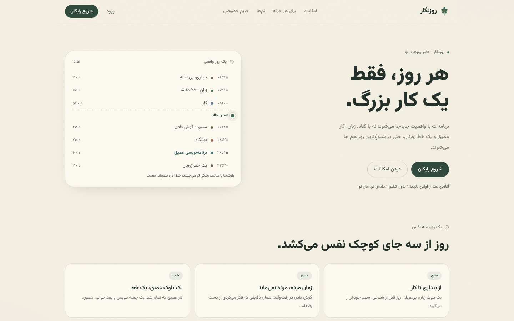
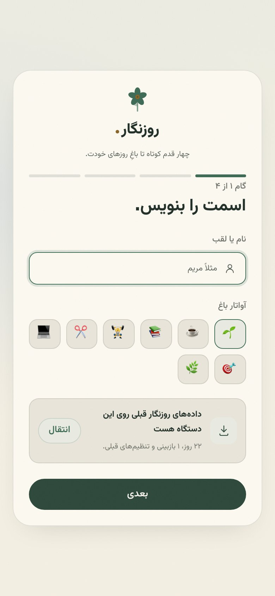
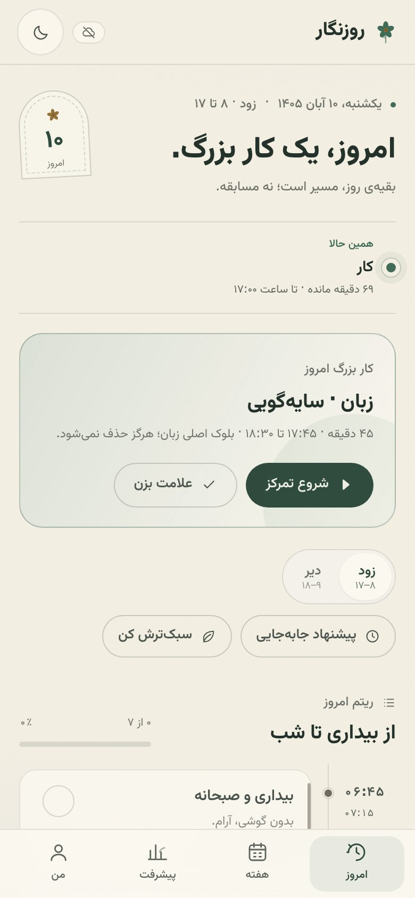
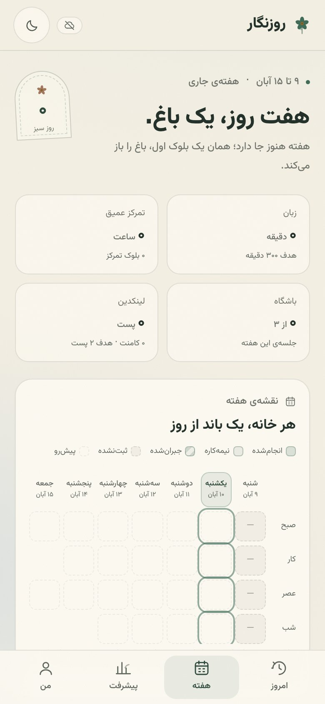
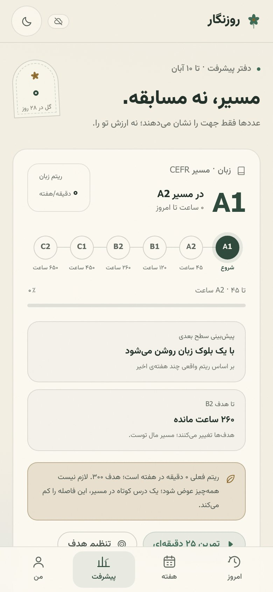
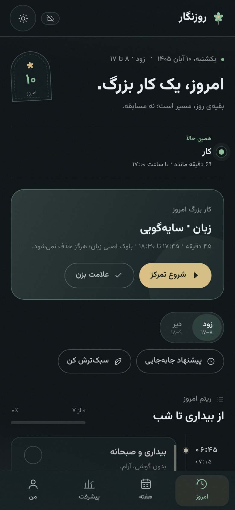
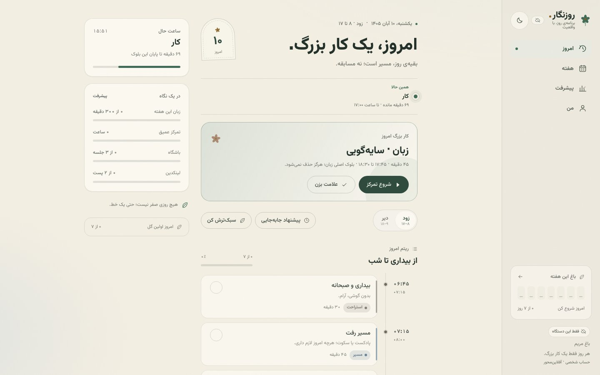
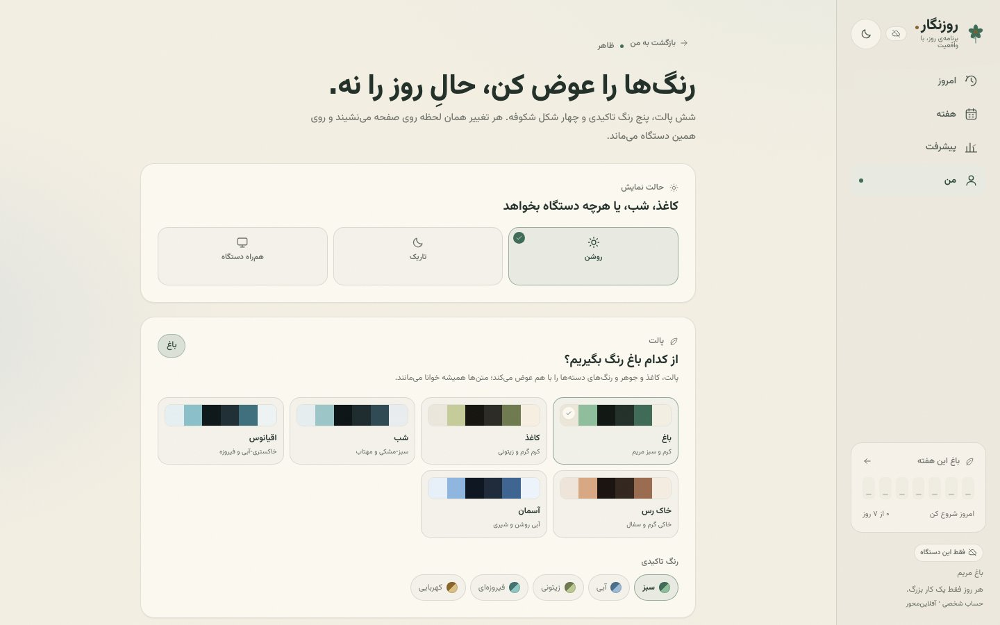
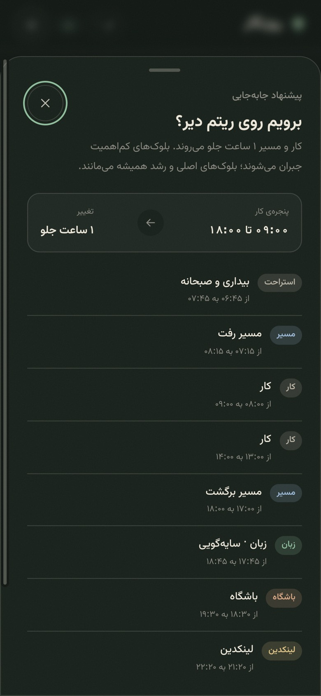
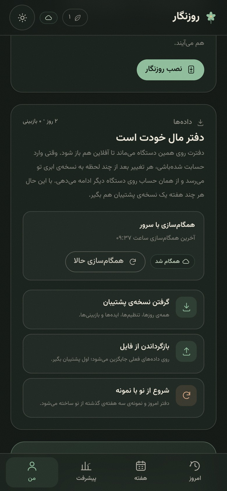

# روزنگار

یک برنامه‌ریز روزانه‌ی شخصی، فارسی و راست‌به‌چپ؛ با حساب کاربری، ایمیل واقعی و دفتری که با تو همگام می‌شود. روزنگار قرار نیست یک مدیر وظیفه‌ی دیگر باشد؛ قرار است هر روز فقط **یک کار بزرگ** را سر جای خودش نگه دارد و بقیه‌ی روز را مسیر بسازد.

> هر روز فقط یک کار بزرگ.
> هیچ روزی صفر نیست.

هر حساب دفتر خودش را دارد: اول روی دستگاه ذخیره می‌شود، بعد با Supabase همگام می‌شود. بدون ورود، صفحه‌ی اصلی فقط یک معرفی تک‌صفحه‌ای است و دفتر باز نمی‌شود. هر بخش، دسته، بلوک، ساعت و رنگ را می‌توانی عوض کنی؛ قالب فقط نقطه‌ی شروع است.

## دمو و تصاویر

**نسخه‌ی زنده:** [moeinparvizi.github.io/rooznegar](https://moeinparvizi.github.io/rooznegar/) — نسخه‌ی ۱.۱.۰ روی همین آدرس منتشر شده است. ورود و ثبت‌نام به Supabase وصل است و دفتر بین دستگاه‌ها همگام می‌شود؛ فقط رسیدن ایمیل‌ها (کد ورود و بازیابی رمز) به تنظیم SMTP در Supabase نیاز دارد ([راهنمای Supabase](docs/SUPABASE_SETUP.md)).

<table>
  <tr>
    <td align="center"><br><sub>معرفی · پیش از ورود</sub></td>
    <td align="center"><br><sub>شروع · انتخاب حرفه</sub></td>
  </tr>
  <tr>
    <td align="center"><br><sub>امروز · تم روشن</sub></td>
    <td align="center"><br><sub>هفته · باغ و نقشه</sub></td>
    <td align="center"><br><sub>پیشرفت · مسیر CEFR</sub></td>
  </tr>
  <tr>
    <td align="center"><br><sub>امروز · تم تاریک</sub></td>
    <td align="center"><br><sub>دسکتاپ · دو ستون</sub></td>
  </tr>
  <tr>
    <td align="center" colspan="2"><br><sub>من · ظاهر و پالت‌ها</sub></td>
  </tr>
  <tr>
    <td align="center"><br><sub>امروز · شیت «دیر» در موبایل</sub></td>
    <td align="center"><br><sub>من · همگام‌سازی با سرور</sub></td>
  </tr>
</table>

## وایرفریم متنی · نمای روز

### دسکتاپ (سه ناحیه در RTL)

```text
┌────────────────────────────── نوار کنار راست (۲۳۶px) ──────────────────────────────┐
│  ✿ روزنگار                        [روشن/تاریک]                                    │
│  برنامه‌ی روز، با واقعیت                                                           │
│                                                                                   │
│  ▸ امروز        یک کار بزرگ                                                       │
│    هفته         باغ هفت روز                                                       │
│    پیشرفت       مسیر و ریتم                                                       │
│    من           تنظیم‌ها                                                          │
│                                                                                   │
│  ┌ باغ این هفته ─────────────────────────────┐                                    │
│  │ ۲۱ روز پیاپی            ۶ از ۷ روز         │                                    │
│  │  ✿   ✿   ✿   ✿   ✿   ✿   ○               │                                    │
│  └────────────────────────────────────────────┘                                    │
│  هر روز فقط یک کار بزرگ.                                                          │
│  دفتر شخصی · حساب من                                                              │
└───────────────────────────────────────────────────────────────────────────────────┘

┌──────────────────── ستون اصلی (حداکثر ۸۸۰px) ────────────────┬── نگاه سریع (۲۵۲px) ──┐
│ چهارشنبه، ۶ آبان ۱۴۰۵ · زود · ۸ تا ۱۷        [برگ روز]        │ ساعت حال  ۱۵:۱۴      │
│                                                              │ کار · ۱۰۶ دقیقه مانده │
│ امروز، یک کار بزرگ.                                          │                       │
│ بقیه‌ی روز، مسیر است؛ نه مسابقه.                             │ در یک نگاه            │
│                                                              │ زبان این هفته ۲۳۰/۳۰۰│
│ ── همین حالا ───────────────────────────────                 │ تمرکز عمیق   ۳ ساعت   │
│ ● کار                                          [نفس سبز]     │ باشگاه       ۲ از ۳   │
│   ۱۰۶ دقیقه مانده · تا ساعت ۱۷:۰۰                            │ لینکدین      ۲ از ۲   │
│                                                              │                       │
│ ┌ کار بزرگ امروز ──────────────────────────────────────────┐ │ باغ با یک گل هم       │
│ │ برنامه‌نویسی عمیق                                         │ │ شروع می‌شود.          │
│ │ ۵۰ دقیقه · ۲۰:۳۰ تا ۲۱:۲۰ · فقط یک موضوع               │ │ ۲۱ روز پیاپی · ۶ از ۷ │
│ │                                                          │ └───────────────────────┘
│ │ [▶ شروع تمرکز]                    [✓ علامت بزن]          │
│ └──────────────────────────────────────────────────────────┘
│
│ [زود ۸–۱۷] [دیر ۹–۱۸]     [پیشنهاد جابه‌جایی] [سبک‌ترش کن]
│
│ ── ریتم امروز ─────────────────────────────── ۰ از ۸ · ۰٪  │
│ ۰۶:۴۵ ┃●  بیداری و صبحانه · ۳۰ دقیقه                        │
│ ۰۷:۱۵ ┃   مسیر رفت · ۴۵ دقیقه                               │
│ ۰۸:۰۰ ┃   کار · ۴ ساعت و ۱۵ دقیقه                           │
│ ۱۲:۱۵ ┃   ناهار و هوای تازه · ۴۵ دقیقه                      │
│ ۱۳:۰۰ ┃   کار · ۴ ساعت                                      │
│        ┃╌╌ اکنون، ساعت ۱۵:۱۴ ╌╌╌╌╌╌╌╌╌╌╌╌╌╌╌╌╌╌╌╌╌╌╌╌╌╌╌   │
│ ۱۷:۰۰ ┃   مسیر برگشت · ۴۵ دقیقه · پادکست یا سکوت             │
│ ۱۷:۴۵ ┃   زبان · سایه‌گویی · ۴۵ دقیقه                       │
│ ۱۸:۳۰ ┃   باشگاه · بازو و شکم · ۱ ساعت و ۱۵ دقیقه           │
│ ۱۹:۴۵ ┃   شام و استراحت · ۴۵ دقیقه                          │
│ ۲۰:۳۰ ┃★  برنامه‌نویسی عمیق · ۵۰ دقیقه · کار بزرگ           │
│ ۲۱:۲۰ ┃   لینکدین · ۲۰ دقیقه                                 │
│ ۲۱:۵۰ ┃   ژورنال یک‌خطی · ۲۰ دقیقه                          │
│
│ ── ژورنال یک‌خطی ──────────────────────────────────────────  │
│ امروز چه چیزی ارزش یادآوری دارد؟                              │
│ [ یک جمله؛ نه گزارش، نه دفاعیه.                    ]          │
│ ۰ از ۱۸۰ نویسه                              [همین را نگه دار]
└──────────────────────────────────────────────────────────────┴───────────────────────┘
```

### موبایل (تک‌ستونی + تب پایین)

```text
┌──────────────────────────────────────────────┐
│  ☾        ✿ ۲۱        روزنگار ✿              │  ← نوار بالا
├──────────────────────────────────────────────┤
│  [برگ روز]    چهارشنبه، ۶ آبان · زود · ۸ تا ۱۷│
│                                              │
│               امروز، یک کار بزرگ.            │
│          بقیه‌ی روز، مسیر است؛ نه مسابقه.     │
│                                              │
│  ── همین حالا ─────────────────────────────  │
│  ● کار                                      │
│    ۱۰۶ دقیقه مانده · تا ساعت ۱۷:۰۰           │
│                                              │
│  ┌ کار بزرگ امروز ────────────────────────┐  │
│  │ برنامه‌نویسی عمیق                        │  │
│  │ ۵۰ دقیقه · ۲۰:۳۰ تا ۲۱:۲۰              │  │
│  │ [▶ شروع تمرکز]        [✓ علامت بزن]    │  │
│  └─────────────────────────────────────────┘  │
│                                              │
│  [زود ۸–۱۷ | دیر ۹–۱۸]        [پیشنهاد] [سبک]│
│  ── ریتم امروز ────────────────────────────  │
│  خط زمان عمودی با نفس سبز روی بلوک جاری      │
│  …                                           │
│  ── ژورنال یک‌خطی ─────────────────────────  │
├──────────────────────────────────────────────┤
│   [امروز]      [هفته]      [پیشرفت]   [من]  │
└──────────────────────────────────────────────┘
```

## قابلیت‌ها

- **حساب با ایمیل واقعی**: ثبت‌نام با رمز، تأیید با کد شش‌رقمی، ورود با رمز یا کد، و بازیابی رمز. تا ایمیل تأیید نشود، دفتر باز نمی‌شود.
- **معرفی تک‌صفحه‌ای پیش از ورود**: همه‌ی امکانات، حرفه‌ها و پالت‌ها در یک صفحه؛ بدون حساب هیچ داده‌ای دیده نمی‌شود.
- **شروع چهار مرحله‌ای**: اسم و آواتار، انتخاب حرفه (برنامه‌نویس، ورزشکار، خیاط، دانشجو، ساده یا دلخواه)، ریتم روز، و نور/پالت. قالب فقط نقطه‌ی شروع است.
- **کاستومایز کامل**: هر ماژول را روشن/خاموش کن؛ دسته بساز و رنگ/آیکون بده؛ بلوک‌های قالب هفته را جابه‌جا یا عوض کن. زبان، تمرکز، باشگاه، لینکدین، ژورنال، باغ، بازبینی و یادآورها همه اختیاری‌اند.
- **تم‌ها**: هفت پالت (باغ، کاغذ، شب، اقیانوس، خاک رس، آسمان، دراکولا) × روشن/تاریک/خودکار + پنج رنگ تاکیدی + سبک گل.
- **خط زمانی روز** با بلوک جاری، خط «اکنون» نفس‌کش و علامت‌زدن هر بلوک.
- **حالت زود/دیر** با موتور جابه‌جایی و پیشنهاد شفاف؛ مقدار جابه‌جایی («میزان دیرتر رفتن»، ۱۵ تا ۱۸۰ دقیقه) را خودت در «من › ریتم روز» تنظیم می‌کنی و همان عدد در همه‌ی برچسب‌ها نشان داده می‌شود.
- **سبک‌سازی و جبران**: هر بلوکِ قابل‌حذف را سبک کن؛ بلوک‌های اصلی کوتاه می‌شوند و جبران به پنجشنبه می‌رود.
- **حالت مسیر** با انتخاب پادکست یا استراحت و تایمر ۲۵ دقیقه‌ای؛ زمان پادکست به زبان اضافه می‌شود.
- **تایمر تمرکز ۲۵/۵ و ۵۰/۱۰** با ثبت چند دقیقه‌ی کوتاه‌شده به‌جای صفر.
- **نقشه‌ی هفت‌روزه** با وضعیت انجام‌شده / نیمه‌کاره / جبران‌شده / پیش‌رو.
- **مسیر CEFR** با ساعت تجمعی، پیش‌بینی سطح بعدی، ریتم هفتگی و هشدار آرام.
- **باشگاه** با چرخه‌ی عضلات و پیشنهاد جبران یک جلسه، نه کل هفته؛ روزهای تمرین را خودت انتخاب می‌کنی و تا انتخاب نکنی جلسه‌ای چیده نمی‌شود.
- **لینکدین** با هدف پست/کامنت، ساعت پیشنهادی، ایده‌ها و تقویم محتوا.
- **مرور پنجشنبه ۱۶–۱۷** با پنج پرسش و پیشنهاد هدف‌های هفته‌ی بعد.
- **یادآورهای محلی** برای شروع بلوک، قاعده‌ی پایان روز و صبح اختیاری.
- **ژورنال یک‌خطی، زنجیره و باغ روزها**؛ روز خالی خاکستر نمی‌شود و قانون گل را خودت انتخاب می‌کنی (یک بلوک، نیمه، یا کار بزرگ).
- **دفتر محلی + همگام‌سازی ابری**: ذخیره‌ی فوری روی دستگاه، و همگام‌سازی last-write-wins با Supabase؛ داده‌ها با RLS جدا می‌مانند. دکمه‌ی «همگام‌سازی حالا» و «آخرین همگام‌سازی ساعت …» در «من › داده‌ها»، علاوه بر سینک خودکار.
- **PWA آفلاین** با manifest، آیکون‌های نصب و service worker؛ بعد از اولین بازدید، پوسته بدون اینترنت هم باز می‌شود. خروجی/ورودی JSON همیشه در دسترس است.

## اجرا

نیاز: Node.js 20.9 یا بالاتر.

```bash
npm install
npm run dev
```

- بدون متغیرهای Supabase و روی `localhost` در حالت توسعه، **ورود آزمایشی** فعال است و کد همیشه `123456` است. داده‌ها بین حساب‌های همین مرورگر جدا می‌مانند.
- برای ایمیل واقعی، `.env.example` را به `.env.local` کپی کن و دو مقدار عمومی Supabase را بگذار؛ جزئیات در [docs/SUPABASE_SETUP.md](docs/SUPABASE_SETUP.md).
- در خروجی تولید بدون Supabase، صفحه‌ی ورود پیام «هنوز فعال نشده» نشان می‌دهد و اپ عمداً قفل می‌ماند.

نسخه‌ی تولید:

```bash
npm run build
npx serve out
```

## انتشار روی GitHub Pages

برای مسیر `https://<user>.github.io/rooznegar/` باید مسیر پایه تنظیم شود:

```bash
NEXT_PUBLIC_BASE_PATH=/rooznegar npm run build
```

فایل `.github/workflows/deploy.yml` همین کار را خودکار انجام می‌دهد: با هر push روی `main`، سایت ساخته و روی GitHub Pages منتشر می‌شود. در تنظیمات مخزن، **Settings → Pages → Source** باید روی **GitHub Actions** باشد.

قبل از انتشار، دو متغیر `NEXT_PUBLIC_SUPABASE_URL` و `NEXT_PUBLIC_SUPABASE_ANON_KEY` را در **Settings → Secrets and variables → Actions → Variables** اضافه کن. فقط **anon public key** برای مرورگر است؛ `service_role` و رمز SMTP هرگز در مخزن یا workflow قرار نمی‌گیرند. راهنمای کامل: [docs/SUPABASE_SETUP.md](docs/SUPABASE_SETUP.md).

اگر مخزن با نام دیگری منتشر شد، مقدار `NEXT_PUBLIC_BASE_PATH` در workflow را با نام همان مخزن هماهنگ کنید.

## داده‌ها

- هر حساب کلید خودش را دارد: `rooznegar-v2:<userId>` در localStorage؛ نسخه‌ی قدیمی `rooznegar-v1` در اولین ورود منتقل می‌شود.
- ظاهر در `rz-theme` و `rz-appearance` نگه داشته می‌شود؛ نشست ورود در `rz-supabase-auth`.
- هر تغییر اول محلی ذخیره می‌شود و بعد با جدول `planner_data` در Supabase همگام می‌شود (last-write-wins). RLS فقط ردیف خودِ کاربر را باز می‌کند.
- در **من → داده‌ها** می‌توانی نسخه‌ی JSON بگیری، برگردانی یا دفتر را از نو باز کنی.

## ساختار

```text
src/app/(public)/   معرفی تک‌صفحه‌ای، ورود، بازیابی رمز
src/app/(app)/      دفتر قفل‌شده: امروز، هفته، پیشرفت، من، ویرایشگرها، شروع
src/lib/auth/       ورود آزمایشی محلی و Supabase
src/lib/sync/       تصمیم همگام‌سازی و انتقال planner_data
src/lib/            موتور برنامه، قالب‌ها، آمار، ظاهر، ذخیره‌سازی، تقویم جلالی
supabase/migrations/ جدول planner_data و RLS
docs/SUPABASE_SETUP.md  راه‌اندازی ایمیل، SMTP، RLS و انتشار
scripts/build-sw.mjs    ساخت service worker و پیش‌کش پس از export
public/fonts/           وزیرمتن (عربی + لاتین)
```

## اصول

- هر روز فقط یک کار بزرگ؛ بقیه مسیر است.
- زبان و برنامه‌نویسی هیچ‌وقت حذف نمی‌شوند؛ فقط کوتاه می‌شوند.
- روز بد، باغ را نمی‌سوزاند.
- هیچ قرمزی‌ای تو را سرزنش نمی‌کند.

---

ساخته‌شده برای استفاده‌ی شخصی؛ بدون تحلیل، بدون مقایسه، بدون فشار.
